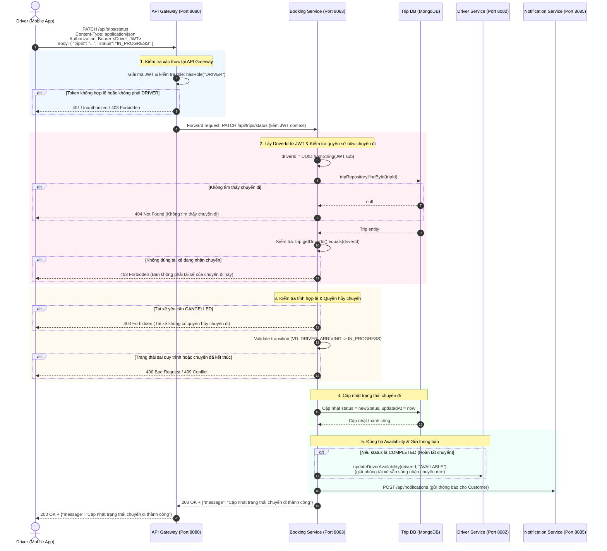

# Booking Service

`bookingservice` lưu dữ liệu đặt chuyến, nhà hàng, món ăn và offer ghép tài xế. Service này dùng MongoDB và yêu cầu JWT hợp lệ từ `userservice`.

> **Lưu ý kiến trúc**: Định danh tài xế (`driverId`) đồng nhất với `userId` (lấy từ JWT subject `sub`). Booking Service không cần gọi API phụ để tra cứu `driverId` từ `userId`, mà chỉ gọi Driver Service để kiểm tra trạng thái khả dụng (`check-available`) hoặc cập nhật `availability`.

## Cấu hình chính

- Port mặc định: `8083`, có thể đổi bằng `BOOKING_SERVICE_PORT`.
- Database: MongoDB `driverapp_booking_db`.
- JWT issuer/JWKS: mặc định `http://localhost:8081`.

## Endpoint hiện có

### 1. Driver Cập Nhật Trạng Thái Chuyến Đi (`PATCH /api/trips/status`)

Cho phép tài xế (`ROLE_DRIVER`) cập nhật tiến độ chuyến đi theo vòng đời chuyến đi.

- **HTTP Method**: `PATCH`
- **Endpoint**: `/api/trips/status`
- **Xác thực**: Bearer JWT Token (`ROLE_DRIVER`)
- **Headers**:
  ```http
  Authorization: Bearer <Driver_JWT>
  Content-Type: application/json
  Accept: application/json
  ```

#### Sơ đồ tuần tự (Sequence Diagram)



#### Request Body (JSON)
```json
{
  "tripId": "651f8a7e2b3c4d5e6f7a8b9c",
  "status": "IN_PROGRESS"
}
```

| Trường | Kiểu dữ liệu | Bắt buộc | Mô tả |
| :--- | :--- | :--- | :--- |
| `tripId` | `String` | Có | ID chuyến đi trên MongoDB |
| `status` | `TripStatus` | Có | Trạng thái mới: `DRIVER_ARRIVING`, `IN_PROGRESS`, `COMPLETED` |

#### Quy tắc nghiệp vụ (Business Rules)
1. **Kiểm tra quyền sở hữu (Driver Ownership Check)**: Lấy `driverId` trực tiếp từ JWT subject (`JWT.sub`). Kiểm tra `trip.getDriverId().equals(driverId)`. Nếu chuyến đi không thuộc về tài xế đang thực hiện, hệ thống trả về lỗi **`403 Forbidden`**.
2. **Chặn quyền hủy chuyến của tài xế**: Tài xế **không được phép** gửi trạng thái `CANCELLED`. Nếu gửi `status = "CANCELLED"`, hệ thống trả về lỗi **`403 Forbidden`** (*"Tài xế không có quyền hủy chuyến đi"*).
3. **Quy trình chuyển trạng thái một chiều hợp lệ**:
   - `DRIVER_ASSIGNED` ➔ `DRIVER_ARRIVING` (Tài xế đang đến điểm đón).
   - `DRIVER_ARRIVING` ➔ `IN_PROGRESS` (Đã đón khách / Bắt đầu hành trình).
   - `IN_PROGRESS` ➔ `COMPLETED` (Đã tới điểm đến / Hoàn tất chuyến đi).
   - Nếu chuyển đổi không theo đúng thứ tự, hệ thống trả về lỗi **`400 Bad Request`**.
4. **Kiểm tra chuyến đã kết thúc**: Nếu chuyến đi đã ở trạng thái `COMPLETED` hoặc `CANCELLED`, trả về lỗi **`409 Conflict`**.
5. **Đồng bộ Availability**: Khi trạng thái chuyển sang `COMPLETED`, hệ thống tự động gọi sang Driver Service (`driverServiceClient.updateDriverAvailability(driverId, "AVAILABLE")`) để giải phóng tài xế, cho phép tài xế nhận các chuyến đi mới.
6. **Bắn thông báo thời gian thực**: Gửi thông báo đến Notification Service (`notificationClient.createNotification`) cho khách hàng tương ứng với mỗi mốc trạng thái mới.

#### Response Body (`200 OK`)
```json
{
  "message": "Cập nhật trạng thái chuyến đi thành công"
}
```

#### Bảng mã lỗi phản hồi
| Mã lỗi | Nguyên nhân |
| :--- | :--- |
| `400 Bad Request` | `tripId` hoặc `status` trống/không hợp lệ; hoặc chuyển sai luồng trạng thái |
| `401 Unauthorized` | Token JWT không hợp lệ hoặc đã hết hạn |
| `403 Forbidden` | Tài xế không phải người nhận chuyến đi này, hoặc tài xế cố tình gửi trạng thái `CANCELLED` |
| `404 Not Found` | Không tìm thấy chuyến đi với `tripId` tương ứng hoặc không tìm thấy hồ sơ tài xế |
| `409 Conflict` | Chuyến đi đã kết thúc (`COMPLETED` hoặc `CANCELLED`) |
| `500 Internal Server Error` | Lỗi cập nhật cơ sở dữ liệu MongoDB |

---

### 2. Tạo Chuyến Đi (`POST /api/trips`)

Khách hàng (`ROLE_CUSTOMER`) tạo yêu cầu đặt chuyến (chở người, giao hàng, đặt món).

- **HTTP Method**: `POST`
- **Endpoint**: `/api/trips`
- **Xác thực**: Bearer JWT Token (`ROLE_CUSTOMER`)
- **Cơ chế Tự Động Khởi Tạo Thanh Toán**:
  - Lưu bản ghi chuyến đi với trạng thái `SEARCHING_DRIVER`.
  - Phát sự kiện bất đồng bộ `trip.created` lên RabbitMQ `trip.topic.exchange`.
  - `paymentservice` tự động lắng nghe và khởi tạo thông tin thanh toán mặc định với phương thức **`PAY_DIRECTLY`** (trạng thái `PENDING`).
- **Request Body**:
  ```json
  {
    "pickUpLatitude": 10.762622,
    "pickUpLongitude": 106.660172,
    "pickUpAddress": "123 Lê Lợi, Quận 1",
    "destinationLatitude": 10.776889,
    "destinationLongitude": 106.700806,
    "destinationAddress": "456 Nguyễn Thị Minh Khai, Quận 3",
    "shippingType": "PASSENGER",
    "vehicleType": "MOTORBIKE",
    "shippFare": 35000.0
  }
  ```
- **Response (`201 Created`)**:
  ```json
  {
    "tripId": "651f8a7e2b3c4d5e6f7a8b9c",
    "message": "Tạo chuyến thành công"
  }
  ```

---

### 3. Tài Xế Nhận Chuyến (`POST /api/trips/{tripId}/accept`)

Tài xế (`ROLE_DRIVER`) chấp nhận thực hiện một chuyến đi đang tìm tài xế.

- **HTTP Method**: `POST`
- **Endpoint**: `/api/trips/{tripId}/accept`
- **Xác thực**: Bearer JWT Token (`ROLE_DRIVER`)
- **Cơ chế**:
  - Lấy `driverId` trực tiếp từ `JWT.sub`.
  - Kiểm tra tài xế đang `AVAILABLE` qua `driverServiceClient.checkDriverAvailable(driverId)`.
  - Atomic update chuyến đi từ trạng thái `SEARCHING_DRIVER` sang `DRIVER_ASSIGNED`.
  - Phát sự kiện `trip.driver-assigned` lên `trip.topic.exchange` để `paymentservice` cập nhật `driverId` vào bản ghi thanh toán (vẫn giữ nguyên phương thức `PAY_DIRECTLY`).
- **Response (`200 OK`)**:
  ```json
  {
    "tripId": "651f8a7e2b3c4d5e6f7a8b9c",
    "status": "DRIVER_ASSIGNED",
    "message": "Nhận chuyến thành công"
  }
  ```

---

### 4. Cơ chế SAGA Pattern & Bù Trừ (Compensating Transaction)

Hệ thống triển khai mô hình SAGA Choreography qua RabbitMQ Direct Exchange (`saga.compensating.exchange`):

1. **Rollback Khởi Tạo Thanh Toán (`TripPaymentInitRollbackListener`)**:
   - Khi `paymentservice` không thể tạo bản ghi thanh toán mặc định (sau khi thử lại qua Dead Letter Queue), event bù trừ `trip.payment-init.failed` sẽ được gửi về `trip.payment-init.failed.queue`.
   - `bookingservice` lập tức:
     - Gửi thông báo lỗi tới khách hàng qua `NotificationClient` ("Hệ thống gặp sự cố khi khởi tạo thanh toán...").
     - **Xóa hoàn toàn chuyến đi vừa tạo khỏi MongoDB** (`tripRepository.delete(trip)`), giúp khách hàng không bị chặn khi đặt chuyến mới.
     - Ghi nhận lịch sử bù trừ vào bảng `saga_compensation_log` với `afterState = "DELETED"`.

2. **Rollback Trạng Thái Khả Dụng Tài Xế (`DriverAvailabilityRollbackListener`)**:
   - Khi cập nhật trạng thái tài xế thất bại, tự động hoàn nguyên cuốc xe về `SEARCHING_DRIVER`.

---

## Giải thích file

- `pom.xml`: khai báo Spring WebMVC, Spring Data MongoDB, RabbitMQ, Security, OAuth2 Resource Server, Validation, Lombok và test dependency.
- `src/main/java/com/driverapp/bookingservice/BookingserviceApplication.java`: class main khởi động service.
- `client/DriverServiceClient.java`: RestClient giao tiếp với Driver Service để kiểm tra tài xế khả dụng (`checkDriverAvailable/{driverId}`).
- `client/NotificationClient.java`: RestClient gửi thông báo thời gian thực sang Notification Service.
- `client/PaymentServiceClient.java`: RestClient giao tiếp nội bộ với Payment Service.
- `config/SecurityConfig.java`: tắt CSRF, dùng session stateless, mở quyền cho các endpoint nội bộ `/api/trips/internal/**` và yêu cầu JWT cho các request còn lại.
- `config/rabbitmq/BookingRabbitMQConfig.java`: cấu hình RabbitMQ Topic Exchange `trip.topic.exchange`, exchange bù trừ `saga.compensating.exchange`, các queue và binding cho SAGA rollback.
- `controller/TripController.java`: các endpoint liên quan đến chuyến đi (`POST /api/trips`, `POST /api/trips/{tripId}/accept`, `PATCH /api/trips/status`, `PATCH /api/trips/{tripId}/cancel`).
- `controller/FoodController.java`: các endpoint CRUD món ăn.
- `controller/RestaurantController.java`: các endpoint quản lý nhà hàng.
- `controller/BusinessRegistrationController.java`: endpoint đăng ký đối tác kinh doanh.
- `dto/request/`: các DTO request đặt chuyến, cập nhật trạng thái, hủy chuyến, đặt đồ ăn.
- `dto/response/`: các DTO response tạo chuyến, nhận chuyến, giá vé.
- `event/`: các class payload sự kiện Domain Event và SAGA (`TripEventPayload`, `TripPaymentInitFailedPayload`, `PaymentCompleteFailedPayload`, ...).
- `listener/saga/`: các listener lắng nghe sự kiện bù trừ SAGA (`TripPaymentInitRollbackListener`, `DriverAvailabilityRollbackListener`, `PaymentInconsistencyListener`).
- `publisher/TripEventPublisher.java`: phát sự kiện chuyến đi lên RabbitMQ (`trip.created`, `trip.driver-assigned`, `trip.completed`, `trip.cancelled`).
- `models/Trip.java`: Mongo document `trips`.
- `models/SagaCompensationLog.java`: Mongo document `saga_compensation_log` lưu lịch sử bù trừ SAGA.
- `models/Restaurant.java`, `models/Food.java`, `models/FoodOption.java`, `models/MatchingOffer.java`.
- `models/enums/`: enum `TripStatus`, `ShippingType`, `VehicleType`, `MatchingOfferStatus`.
- `repository/`: Spring Data MongoDB repositories (`TripRepository`, `SagaCompensationLogRepository`, ...).
- `service/TripService.java` & `service/impl/TripServiceImpl.java`: Logic tạo chuyến, phát event thanh toán, nhận chuyến, chuyển trạng thái và hoàn tất cuốc xe.
- `src/main/resources/application.yaml`: cấu hình port, MongoDB URI, RabbitMQ và JWT resource server.

## Cách chạy

```bash
cd bookingservice
./mvnw spring-boot:run
```
