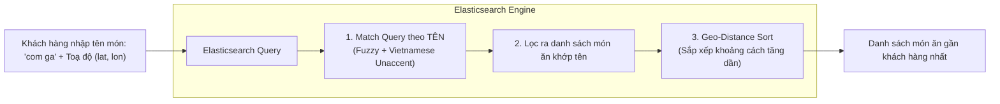

# Hướng Dẫn Áp Dụng Elasticsearch Trong Tìm Kiếm Đồ Ăn Theo Tên & Sắp Xếp Theo Khoảng Cách

> **Mục tiêu**: Tối ưu hóa tính năng tìm kiếm món ăn trong hệ thống (`bookingservice`):
> - **Tìm kiếm**: Chỉ tìm kiếm món ăn theo **tên món** (hỗ trợ tiếng Việt có dấu/không dấu, chấp nhận lỗi chính tả fuzzy search, gợi ý autocomplete). Không giới hạn hay lọc theo bán kính địa lý.
> - **Sắp xếp**: Kết quả trả về được **sắp xếp theo khoảng cách (Geo-distance Sort)** từ gần nhất đến xa nhất dựa vào toạ độ hiện tại của người dùng.

---

## 1. Cơ Chế Hoạt Động Của Elasticsearch

### 1.1. Luồng xử lý truy vấn



### 1.2. Phân tích kỹ thuật

1. **Tìm kiếm theo tên (Match & Multi-Match)**:
   - Sử dụng Analyzer chuẩn hóa tiếng Việt (`asciifolding`, `lowercase`) để khi người dùng gõ `com tam`, `com ga`, `bún bò` thì hệ thống đều phân tích và khớp chính xác các món tương ứng dù có dấu hay không dấu.
   - Bật tính năng **Fuzzy Matching** (`fuzziness: "AUTO"`) để bắt lỗi chính tả (ví dụ gõ nhầm `"piza"` $\rightarrow$ `"pizza"`).
   - Không áp dụng bộ lọc bán kính (`geo_distance filter`) để đảm bảo không bỏ sót bất kỳ món ăn nào phù hợp với tên tìm kiếm.

2. **Sắp xếp theo khoảng cách (Geo-distance Sorting)**:
   - Elasticsearch lưu toạ độ quán của món ăn dưới dạng `geo_point` (`restaurantLocation: { "lat": ..., "lon": ... }`).
   - Khi client gửi toạ độ của người dùng (`userLatitude`, `userLongitude`), Elasticsearch sẽ áp dụng mệnh đề `sort: _geo_distance` theo thứ tự `asc` (tăng dần).
   - Món ăn nào ở quán gần người dùng nhất sẽ hiển thị lên đầu tiên. Nếu người dùng không bật định vị, hệ thống tự động fallback sắp xếp theo độ liên quan (`_score`).

3. **Cấu trúc Raw Elasticsearch Query mẫu**:
```json
{
  "query": {
    "multi_match": {
      "query": "cơm gà",
      "fields": ["name^3", "name.autocomplete^2"],
      "fuzziness": "AUTO"
    }
  },
  "sort": [
    {
      "_geo_distance": {
        "restaurantLocation": {
          "lat": 10.7769,
          "lon": 106.6956
        },
        "order": "asc",
        "unit": "km",
        "distance_type": "arc"
      }
    }
  ]
}
```

---

## 2. Cấu Trúc Thư Mục Đã Triển Khai

Toàn bộ code được cấu trúc trong module `bookingservice`:

```text
bookingservice/
├── pom.xml                                      <-- [Đã thêm] Thêm spring-boot-starter-data-elasticsearch
├── src/
│   └── main/
│       ├── java/
│       │   └── com/
│       │       └── driverapp/
│       │           └── bookingservice/
│       │               ├── config/
│       │               │   └── SecurityConfig.java             <-- [Đã sửa] permitAll cho /api/bookings/foods/search/**
│       │               ├── controller/
│       │               │   ├── FoodController.java             <-- [Giữ nguyên] CRUD món ăn hiện tại
│       │               │   └── FoodSearchController.java       <-- [Đã thêm] API tìm kiếm món ăn theo tên & sort khoảng cách
│       │               ├── dto/
│       │               │   ├── request/
│       │               │   │   └── FoodSearchRequest.java      <-- [Đã thêm] DTO nhận keyword và toạ độ người dùng
│       │               │   └── response/
│       │               │       └── FoodSearchResponse.java     <-- [Đã thêm] DTO trả về món ăn + khoảng cách (km)
│       │               ├── elasticsearch/
│       │               │   ├── document/
│       │               │   │   ├── FoodDocument.java           <-- [Đã thêm] Document ES (name + restaurantLocation)
│       │               │   │   └── FoodOptionSubDoc.java       <-- [Đã thêm] Sub-document cho size & price
│       │               │   └── repository/
│       │               │       └── FoodSearchRepository.java   <-- [Đã thêm] Spring Data Elasticsearch Repository
│       │               ├── runner/
│       │               │   └── FoodDataSyncRunner.java         <-- [Đã thêm] Tự động nạp DB mẫu & đồng bộ sang ES
│       │               └── service/
│       │                   ├── FoodSearchService.java          <-- [Đã thêm] Interface tìm kiếm
│       │                   └── impl/
│       │                       ├── FoodSearchServiceImpl.java  <-- [Đã thêm] Xử lý query theo tên + sort khoảng cách
│       │                       └── FoodServiceImpl.java        <-- [Đã sửa] Tự động sync ES khi create, update, delete món
│       └── resources/
│           ├── application.yaml                                <-- [Đã sửa] Cấu hình kết nối Elasticsearch
│           ├── db/
│           │   ├── restaurants.json                            <-- [Đã cập nhật] 11 nhà hàng mẫu với tọa độ chuẩn
│           │   └── foods.json                                  <-- [Đã tạo mới] 24 món ăn mẫu đa dạng
│           └── elasticsearch/
│               └── food-index-settings.json                    <-- [Đã thêm] Analyzer tiếng Việt & Autocomplete
└── docker-compose.yml                                          <-- [Đã thêm] Thêm service elasticsearch
```

---

## 3. Chi Tiết File Dữ Liệu Mẫu Cho Database (`restaurants.json` & `foods.json`)

Hệ thống đã chuẩn bị sẵn 2 file JSON chứa dữ liệu thử nghiệm phong phú tại:
1. `bookingservice/src/main/resources/db/restaurants.json` (và [document/restaurants.json](file:///home/thanhtiendo/driver_app/backend/document/restaurants.json))
2. `bookingservice/src/main/resources/db/foods.json` (và [document/foods.json](file:///home/thanhtiendo/driver_app/backend/document/foods.json))

### 3.1. Danh mục nhà hàng mẫu (`restaurants.json`)
Bao gồm 11 nhà hàng phủ khắp các khu vực (Quận 1 TP.HCM, Hà Nội, Đà Nẵng, Hội An, Nha Trang) với toạ độ GPS chính xác:
- **65b000000000000000000003**: Cơm Tấm Sài Gòn (78 Nguyễn Trãi, Quận 1, TP.HCM: `10.7769, 106.6956`)
- **65b000000000000000000006**: Gà Nướng Mật Ong Thuý (56 Đinh Tiên Hoàng, Quận 1, TP.HCM: `10.7891, 106.7012`)
- **65b00000000000000000000a**: Pizza 4P's (8 Thủ Khoa Huân, Quận 1, TP.HCM: `10.7726, 106.7016`)
- **65b00000000000000000000b**: Trà Sữa Gong Cha (83 Hồ Tùng Mậu, Quận 1, TP.HCM: `10.7735, 106.7042`)
- **65b000000000000000000004**: Lẩu Thái Sườn Bò (23 Lê Duẩn, Quận 1, TP.HCM: `10.7802, 106.6985`)
- **65b000000000000000000002**: Bún Bò Huế Bà Lan (Hải Châu, Đà Nẵng: `16.0678, 108.2208`)
- **65b000000000000000000001**: Phở Hà Nội (Hoàn Kiếm, Hà Nội: `21.0285, 105.8542`)
- **65b000000000000000000005**: Bánh Mì Phượng (Hội An: `15.8801, 108.3380`)
- **65b000000000000000000008**: Bún Chả Obama (Hai Bà Trưng, Hà Nội: `21.0200, 105.8500`)
- **65b000000000000000000007**: Mì Quảng Tâm (Hải Châu, Đà Nẵng: `16.0600, 108.2100`)
- **65b000000000000000000009**: Hải Sản Trọng Nghĩa (Nha Trang: `12.2388, 109.1967`)

### 3.2. Danh mục món ăn mẫu (`foods.json`)
Bao gồm 24 món ăn với đầy đủ các kích cỡ (size) và mức giá, liên kết trực tiếp với nhà hàng tương ứng:

| Nhóm món | Tên món tiêu biểu trong file JSON | Mục đích kiểm thử API |
| :--- | :--- | :--- |
| **Cơm** | - Cơm gà xối mỡ giòn rụm<br/>- Cơm tấm sườn bì chả<br/>- Cơm tấm sườn nướng mật ong<br/>- Cơm gà luộc Hải Nam<br/>- Cơm gà xé phay Tam Kỳ | Test tìm kiếm từ khóa `"cơm"`, `"cơm gà"`, `"com ga"` (không dấu). Test sắp xếp khoảng cách giữa quán tại Nguyễn Trãi vs Đinh Tiên Hoàng. |
| **Pizza** | - Pizza hải sản sốt tiêu đen<br/>- Pizza 4 loại phô mai mật ong<br/>- Pizza bò băm xúc xích cay | Test tìm kiếm lỗi chính tả (Fuzzy): gõ `"piza"`, `"pizzza"` vẫn ra kết quả. |
| **Trà / Đồ uống** | - Trà sữa trân châu đường đen<br/>- Trà đào cam sả hoàng kim<br/>- Trà xoài macchiato trân châu trắng<br/>- Trà sữa matcha đậu đỏ | Test gợi ý tức thì (Autocomplete): gõ prefix `"tra"`, `"tra sua"` ra danh sách món đồ uống. |
| **Bún / Phở / Mì** | - Bún bò Huế đặc biệt giò nạm<br/>- Bún bò tái bắp hoa chả cua<br/>- Phở bò tái lăn Hà Nội<br/>- Phở gà ta đùi lá chanh<br/>- Bún chả Hà Nội nướng than hoa<br/>- Mì Quảng ếch đồng rút xương | Test tìm kiếm `"bún bò"`, `"bun bo"`, `"phở"`, `"pho"` khi tắt định vị vs bật định vị. |
| **Lẩu & Hải Sản** | - Lẩu Thái tomyum hải sản chua cay<br/>- Lẩu sườn bò kim chi Hàn Quốc<br/>- Hải sản sốt cajun cay nồng | Test tìm kiếm `"lẩu"`, `"lau"`, `"hải sản"`. |
| **Bánh mì** | - Bánh mì thập cẩm đặc biệt<br/>- Bánh mì heo quay giòn rụm | Test tìm kiếm `"bánh mì"`, `"banh mi"`. |

### 3.3. Cơ chế nạp dữ liệu vào Database

Có 2 cách để nạp dữ liệu mẫu vào MongoDB:

#### Cách 1: Tự động (Khuyên dùng)
Lớp [`FoodDataSyncRunner`](file:///home/thanhtiendo/driver_app/backend/bookingservice/src/main/java/com/driverapp/bookingservice/runner/FoodDataSyncRunner.java) được cấu hình tự động:
1. Khi khởi động `bookingservice`, nếu bảng `restaurants` trong MongoDB rỗng $\rightarrow$ tự động nạp `restaurants.json`.
2. Nếu bảng `foods` trong MongoDB rỗng $\rightarrow$ tự động nạp `foods.json`.
3. Nếu chỉ mục `foods_index` trong Elasticsearch rỗng $\rightarrow$ tự động đồng bộ toàn bộ 24 món ăn sang Elasticsearch.

#### Cách 2: Thủ công qua lệnh `mongoimport`
Nếu muốn reset hoặc nạp bằng dòng lệnh MongoDB:
```bash
# Nạp danh sách nhà hàng
mongoimport --uri="mongodb://localhost:27017/driverapp_booking_db" \
  --collection=restaurants \
  --file=bookingservice/src/main/resources/db/restaurants.json \
  --jsonArray --drop

# Nạp danh sách món ăn
mongoimport --uri="mongodb://localhost:27017/driverapp_booking_db" \
  --collection=foods \
  --file=bookingservice/src/main/resources/db/foods.json \
  --jsonArray --drop

# Đồng bộ dữ liệu sang Elasticsearch
curl -X POST "http://localhost:8083/api/bookings/foods/search/sync-all"
```

---

## 4. Hướng Dẫn Kiểm Thử Toàn Diện API Tìm Kiếm (Testing Guide)

Dưới đây là các kịch bản kiểm thử trực tiếp trên bộ dữ liệu 24 món ăn mẫu:

### 4.1. Kịch bản 1: Tìm kiếm theo tên có dấu + Sắp xếp theo khoảng cách gần nhất
Người dùng ở gần Quận 1 (`lat: 10.7769, lon: 106.6956` - toạ độ tại Cơm Tấm Sài Gòn trên đường Nguyễn Trãi) tìm món `"Cơm gà"`:
```bash
curl -X GET "http://localhost:8083/api/bookings/foods/search?name=Cơm+gà&latitude=10.7769&longitude=106.6956"
```
**Kết quả**:
- `"Cơm gà xối mỡ giòn rụm"` tại Cơm Tấm Sài Gòn hiển thị **đầu tiên** với `distanceKm: 0.0 km`.
- `"Cơm gà luộc Hải Nam"` tại Gà Nướng Thuý (Đinh Tiên Hoàng) đứng **thứ hai** với `distanceKm: ~1.48 km`.
- `"Cơm gà xé phay Tam Kỳ"` tại Đà Nẵng đứng **sau cùng** với `distanceKm: ~604 km`.

---

### 4.2. Kịch bản 2: Tìm kiếm tiếng Việt KHÔNG DẤU
Người dùng gõ nhanh không dấu `"com tam"`:
```bash
curl -X GET "http://localhost:8083/api/bookings/foods/search?name=com+tam&latitude=10.7769&longitude=106.6956"
```
**Kết quả**: Trả về chính xác các món:
- *"Cơm tấm sườn bì chả"*
- *"Cơm tấm sườn nướng mật ong"*

---

### 4.3. Kịch bản 3: Chấp nhận lỗi chính tả nhẹ (Fuzzy Search)
Người dùng gõ nhầm `"piza"` (thiếu chữ 'z'):
```bash
curl -X GET "http://localhost:8083/api/bookings/foods/search?name=piza&latitude=10.7769&longitude=106.6956"
```
**Kết quả**: Elasticsearch tự động nhận diện và trả về:
- *"Pizza 4 loại phô mai mật ong (4 Cheese)"*
- *"Pizza hải sản sốt tiêu đen"*
- *"Pizza bò băm xúc xích cay"*

---

### 4.4. Kịch bản 4: Tìm kiếm khi người dùng tắt định vị (không truyền tọa độ)
```bash
curl -X GET "http://localhost:8083/api/bookings/foods/search?name=bún+bò"
```
**Kết quả**:
- Danh sách món ăn được xếp theo điểm khớp từ khóa (BM25 score).
- Trường `distanceKm` nhận giá trị `null` mà không gây lỗi ứng dụng.

---

### 4.5. Kịch bản 5: Gợi ý từ khóa tự động (Autocomplete)
Gõ chữ `"tra"`:
```bash
curl -X GET "http://localhost:8083/api/bookings/foods/search/suggest?prefix=tra"
```
**Kết quả**:
```json
[
  "Trà sữa trân châu đường đen",
  "Trà đào cam sả hoàng kim",
  "Trà xoài macchiato trân châu trắng",
  "Trà sữa matcha đậu đỏ Nhật Bản"
]
```

---

## 5. File Mẫu HTTP Client (`test-food-search.http`)

Developer có thể mở file [document/test-food-search.http](file:///home/thanhtiendo/driver_app/backend/document/test-food-search.http) trong IntelliJ IDEA hoặc VS Code REST Client để chạy trực tiếp tất cả các request trên.
